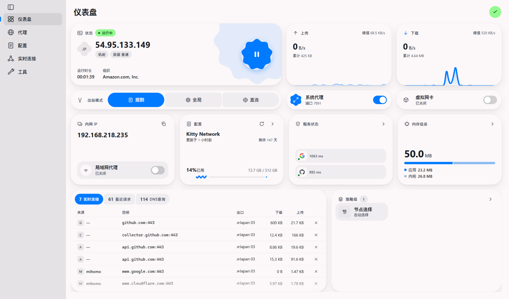

# FlClash-Web



以 [FlClash](https://github.com/chen08209/FlClash) v0.9.3 为参照,用 **Go + SQLite + Svelte** 复刻的 Web 版客户端。
单个二进制,监听一个 HTTP 端口,内置完整 mihomo(Clash.Meta)核心,在 Windows / Linux / macOS 上行为一致。

## 使用

### 1. 下载

从 [Releases](https://github.com/jiqing112/FlClash-Web/releases) 下载对应平台的单文件二进制(约 60MB,前端已内嵌,无其它依赖):

| 文件 | 平台 |
|---|---|
| `flclash-web-windows-amd64.exe` | Windows x64 |
| `flclash-web-linux-amd64` | Linux x64 |
| `flclash-web-linux-arm64` | Linux ARM64(如树莓派、N1 盒子) |
| `flclash-web-darwin-amd64` | macOS Intel |
| `flclash-web-darwin-arm64` | macOS Apple Silicon |

每个 Release 附 `SHA256SUMS` 校验文件。

### 2. 启动

```bash
# macOS / Linux 首次运行需要执行权限
chmod +x flclash-web-*

# 默认监听 http://127.0.0.1:8787
./flclash-web-linux-amd64

# Windows
flclash-web-windows-amd64.exe
```

浏览器打开 `http://127.0.0.1:8787` 即得完整界面。

**命令行参数**:

| 参数 | 默认值 | 说明 |
|---|---|---|
| `-addr` | `127.0.0.1:8787` | 监听地址;改成 `0.0.0.0:8787` 可让局域网内其它设备访问 |
| `-home` | 各平台数据目录(见下) | 数据目录:SQLite 数据库、订阅文件、运行缓存 |

数据目录默认位置:Windows `%AppData%\flclash-web`,macOS `~/Library/Application Support/flclash-web`,Linux `~/.local/share/flclash-web`(遵循 XDG)。

**环境变量**:`GOGC`(默认 50)调节 GC 频率 —— 调低更省内存,调高更流畅;`GOMEMLIMIT` 可设内存软上限。

### 3. 首次配置

1. **导入配置**:左侧「配置」页 → 右下「+」→ 粘贴订阅链接(URL,自动拉取并识别流量/到期信息)或导入本地 YAML 文件。
2. **切换配置**:点击配置卡片即启用(卡片带勾选标记与订阅用量进度)。
3. **启动内核**:回到「仪表盘」,点击右侧花瓣形按钮 —— 绿色「运行中」徽章 + 蓝色花瓣即表示内核已启动。
4. **流量接管**:打开「系统代理」开关(Windows 写注册表 / macOS 调 networksetup / Linux 调 gsettings),或开启「虚拟网卡」(TUN,Windows 需管理员权限运行本程序)。
5. **切换节点**:「代理」页选择策略组,点节点卡片即切换;点节点右下角的闪电图标可单独测延迟,顶部「延迟测试」按钮测全组。

### 4. 页面一览

- **仪表盘**:状态卡(出口 IP/国家/机房·质量徽章/运行时长/组织)、上传与下载曲线、出站模式(规则/全局/直连)、系统代理与 TUN 开关、内网 IP 与局域网代理、配置卡(订阅用量 M3 波浪进度线)、服务状态(Google/GitHub 等探测)、内存信息(应用/内核拆分)、实时连接表、策略组。
- **代理**:tab/list 双模式,排序(默认/延迟/名称),卡片三种尺寸,隐藏超时节点(右上 ⋯ 菜单)。
- **配置**:订阅/本地/自定义三种类型,同步、编辑、删除(同时清理配置文件与缓存)。
- **实时连接**:运行中连接(可单独关闭)与最近请求两个 feed,来源/目标/出口/流量列,点行看详情。
- **DNS 查询 / 日志 / 资源**:DNS 记录与缓存清理、mihomo 日志流、Geo 资源与外部提供者更新。
- **工具**:语言(中/英)、主题(明暗/8 种种子色/4 种配色风格/纯黑)、常规设置(测延迟超时、自动运行等)、网络设置(端口/局域网/TUN/keep-alive 等)。

### 5. 从其它设备访问

```bash
./flclash-web -addr 0.0.0.0:8787
```

然后手机/平板浏览器打开 `http://你的机器IP:8787`。窄屏自动切换为移动布局(底部浮动 dock)。

> ⚠️ 对局域网开放等于把代理控制权暴露给同网段设备,建议只在可信网络使用。

### 6. 常见问题

- **TUN 打不开**:Windows 需以管理员身份运行本程序;Linux 需 root 或相应 capability。
- **系统代理关闭后浏览器还走代理**:原版同样如此,系统代理是全局设置,开关即时生效但浏览器有自己的缓存。
- **端口被占用**:改「工具 → 网络 → 混合端口」,或用 `-home` 换数据目录后重新配置。
- **订阅更新失败**:检查「工具 → 网络 → 测试 URL」是否可达;订阅链接走核心代理,启动内核后才能直连更新。

## CI/CD

- 推送到 `main` 或提交 PR 时,[CI](.github/workflows/ci.yml) 自动构建前端 + 双平台后端并跑 `go vet`。
- 推送 `v*` 标签时,[Release 工作流](.github/workflows/release.yml) 在 GitHub Actions 上自动构建 5 个平台产物,附 SHA256SUMS 发布到 GitHub Releases:

```bash
git tag v1.0.1
git push origin v1.0.1
# → Actions 自动编译 → Releases 页出现全部产物
```

## 从源码构建

```bash
git clone --recursive https://github.com/jiqing112/FlClash-Web.git
cd FlClash-Web

# 依赖:Node.js 20+ 和 Go 1.27+(GOTOOLCHAIN=auto 会自动下载)
./scripts/build.sh    # Windows 用 scripts/build.ps1
```

产物输出到 `dist/flclash-web-<os>-<arch>[.exe]`。

手动分步构建:

```bash
cd frontend && npm ci && npm run build   # 构建 Svelte 前端
cd ../backend && go build -o flclash-web .  # 前端已内嵌进 Go 二进制
```

## 架构

```
┌────────────────────────────── 单个二进制 flclash-web ──────────────────────────────┐
│                                                                                    │
│  Svelte 前端 (go:embed 内嵌)  ←→  REST API + WebSocket  ←→  hub 业务层             │
│                                        │                        │                  │
│                                        │                 SQLite(flclash.db)        │
│                                        │                 配置 / 配置档案            │
│                                        ▼                                           │
│                              FlClash core(原版 Go core,进程内)                     │
│                          ← 命名管道(Win)/ TCP(Unix)帧协议,与桌面版完全相同 →        │
│                                        │                                           │
│                              mihomo(Clash.Meta fork)                              │
└────────────────────────────────────────────────────────────────────────────────────┘
```

**复刻了原版的三层结构**:

- 前端:页面、卡片、主题、i18n(zh_CN/en)直接取自 FlClash 的 `arb/` 文案;配色用与
  prism_ui 相同的 material-color-utilities 算法(`seededColorScheme` 忠实移植,vivid /
  tinted / soft / monochrome 四种风格 + 纯黑模式);图标按 `app_glyphs.dart` 逐个移植(124 个)。
- 后端 hub:移植了 Dart 侧的 `makeRealProfileTask`(配置覆写管线)、`buildGroups` /
  `computeSort`(策略组计算)、setup/updateConfig 控制流、请求/日志/DNS 缓存、系统代理
  (Windows 注册表 / gsettings / networksetup)。
- 核心:**原封不动使用 FlClash 的 Go core 子模块**(含 Clash.Meta fork),
  走和桌面版一样的 IPC 协议(`config.setup` / `proxy.select` / 延迟测速 / 事件批量推送)。

## 功能对照

| 功能 | 状态 |
|---|---|
| 仪表盘(状态卡/出站 IP/网速曲线/出站模式/系统代理/TUN/内网 IP/服务状态/配置卡/策略组/连接统计/内存) | ✅ |
| 代理页(tab/list 双模式、节点卡片、单节点与全组延迟测速、选择节点、排序/尺寸/隐藏超时菜单) | ✅ |
| 配置页(URL/文件导入、订阅下载含 userinfo 流量信息、选择/删除/编辑/同步、自动更新) | ✅ |
| 实时连接页(运行中可单独关闭 + 最近请求,详情弹窗) | ✅ |
| DNS 查询、日志页 | ✅ |
| 资源页(Geo 资源更新、外部代理提供者) | ✅ |
| 工具页(语言/主题/常规/网络设置、关于) | ✅ |
| 主题(明暗/跟随系统、8 种种子色、4 种配色风格、纯黑) | ✅ |
| 中文/英文(文案直接使用原版 arb) | ✅ |
| 侧边栏展开/收起、移动端浮动 dock | ✅ |
| 系统代理(Win 注册表 / macOS networksetup / Linux gsettings) | ✅ |
| 配置覆写(端口/TUN/DNS/hosts/test-url/常规覆写键选择) | ✅ |
| mihomo 全功能(规则分流、TUN、DNS、提供者等,由原版 core 提供) | ✅ |
| 热键、托盘、窗口管理、备份/DAV、MITM、JS 脚本扩展 | ❌ 桌面专属/未实现 |

## 真机对照

前端按 v0.9.3 Windows 实机逐卡重绘:侧栏(220px、灰选中 pill + 3×16 蓝指示条)、
仪表盘 208/64/176 行高网格、cookie-12 blob 装饰、cookie-9 启动按钮、三联出站模式
connected pills(外圆角 24/内 10)、系统代理与虚拟网卡 tile、M3 波浪订阅进度线、
服务状态品牌 logo 探测格、连接表 connected-pill tabs(外圆角 = 高度一半)、
弹出菜单(卡圆角 24、行 44px 悬停 pill、分区标题、行尾勾选)。
所有参数取自 `lib/views/dashboard/**` 与 `plugins/prism_ui/**` 源码。

**订阅实测**:导入 Kitty Network 订阅 → 34 节点/3 组正确解析 → 订阅信息
(72.4 GB / 512 GB、剩余天数)与真机一致 → 全组延迟测速(马来西亚 70ms)→
经 `curl --proxy` 走 🇲🇾Malaysia 02 出口 204 成功 → 请求/流量曲线实时更新。

## 已知差异

- 旗帜 emoji 在 Windows Chrome 上显示为字母(如 "HK"),原版用 twemoji 图片渲染;
  节点自带的 🇭🇰 字符在支持的平台上正常显示。
- TUN 在 Windows 上需要管理员权限运行本程序(mihomo 自身行为,与原版一致;原版桌面
  通过 helper 服务提权,Web 版暂无该机制)。
- JS 脚本覆写、MITM 模块、备份恢复、热键、系统托盘是桌面专属能力,未实现。

## 目录

```
backend/
  main.go               入口(-addr / -home)
  core/                 FlClash 原版 core(clash.meta fork + FlClash 包装层)
  internal/rpc/         帧协议宿主(与桌面版相同的 JSON RPC)
  internal/hub/         业务层(profile 构建、组计算、系统代理、事件泵、内存调优)
  internal/store/       SQLite 存储 profiles + config
  internal/api/         REST + WebSocket + 静态资源(dist 内嵌)
frontend/
  src/pages/            Dashboard / Proxies / Profiles / Requests / Dns / Logs / Resources / Tools
  src/lib/              主题(color+MCU)、i18n(arb)、stores、ws、格式化
  src/i18n/             原版 arb 文案(en / zh_CN)
.github/workflows/      CI(构建校验)+ Release(打 tag 自动发布)
scripts/                跨平台构建脚本
```

## 鸣谢

- [FlClash](https://github.com/chen08209/FlClash) —— 本项目的界面、交互与核心集成方式全部参照 FlClash 复刻,profile 构建管线、策略组计算等业务逻辑由其 Dart 源码移植;感谢作者 [chen08209](https://github.com/chen08209) 与所有贡献者。
- [mihomo(Clash.Meta)](https://github.com/MetaCubeX/mihomo) —— FlClash 内核。
- [material-color-utilities](https://github.com/material-foundation/material-color-utilities) —— 主题配色算法。

## 许可

本项目与 FlClash 一样基于 **[GPL-3.0](LICENSE)** 开源。FlClash 与 mihomo 的代码以各自的开源协议随本仓库分发。
